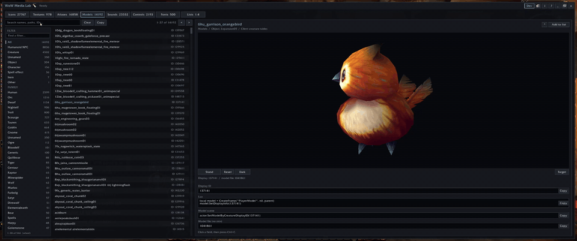
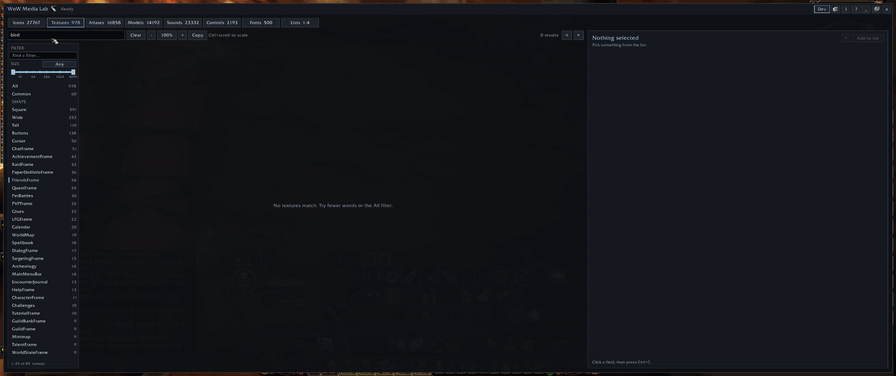
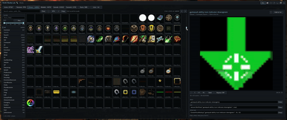
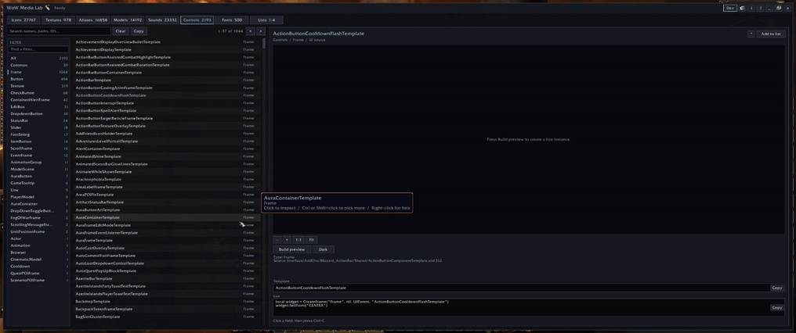

# WoW Media Lab 🧪

**Every icon, texture, sound and creature model in the game, in one window you can open anywhere.**

Ever wanted the perfect icon for a macro, or wondered what that sound was
called, or just wanted to watch a murloc dance? WoW Media Lab is a little
laboratory inside the game. Type `/mlab` and the whole game's art, sound and
creatures are right there: search them, play with them, and keep the ones you
love.

Made for **WoW Forever**. Version **0.2.1**.

## Find the perfect icon

Nearly 28,000 icons, and you can search them by what they *look like*. Type
`sword`, `wolf` or `potion green` and there they are. Hover one to read what it
shows, then scale the grid up to admire the details.

## Meet the whole bestiary

Over 14,000 creature models to spin, tilt, zoom and set dancing, roaring or
attacking. Spot an NPC you like in the world? Target it and the lab finds its
model for you, and remembers its name for next time.

## Hear every sound in the game

More than 23,000 sounds: creature roars, spells, music, ambience and every
click of the interface. Just rest your pointer on one to hear it, see its
waveform, and let the lab play through a whole list for you. It even tells you
what makes the sound, like a creature's attack or a zone's music.

## See the art behind the interface

The textures and pieces the game's windows are built from, up close. Zoom in,
check them on a light or dark background, and tile them to see how a border
fits together.

## Fonts and controls too

Type your own words and see them in every font the game has. And as a bonus,
browse the buttons, frames and sliders the game's windows are made of, and
build a live copy of any of them.

## Keep what you love

Right-click anything to favorite it, or drop it into your own lists: one for
your macros, one for your guild's sounds, one for creatures you want to find.
Pick a whole bunch at once with Ctrl or Shift, just like files on your
computer.

## Making an addon? This is your shortcut

No more hunting through file IDs or guessing sound names. Find what you want
by looking at it, then press **Dev** for the exact line of code to use it:
`SetTexture`, `SetAtlas`, `PlaySound`, `CreateFrame` and more. Collect
everything your addon needs in a list and copy it out as one ready-made Lua
table. The [developer guide](docs/addon-dev.md) has more.

## Install

**With CurseForge (recommended, keeps it up to date):** install
[WoW Media Lab from CurseForge](https://www.curseforge.com/wow/addons/wow-media-lab)
in the CurseForge app, and it updates itself whenever a new version comes out.

**Offline, by hand:** download the zip from
[Releases](https://github.com/codelab-chaos/wow-media-lab/releases) and extract
it into `World of Warcraft/_forever_/Interface/AddOns/`. Come back to Releases
for new versions.

Either way, restart the game and make sure **WoW Media Lab** is enabled in the
AddOns list.

## Open it

Type **`/mlab`**, or click it in the addon menu by the minimap. The lab stocks
its shelves and you're in:

Press **?** in the title bar any time for tips about the tab you're on. All of
them, and what every button does, are also in [the lab's guide](docs/guide.md).

## Slash commands

| Command | Does |
| --- | --- |
| `/mlab` | Opens and closes the lab |
| `/mlab search <words>` | Searches the tab you are on |
| `/mlab tab <name>` | Jumps to a tab: icons, textures, atlases, models, sounds, controls, fonts, lists |
| `/mlab target` | Finds your target's model and remembers its name |
| `/mlab reset` | Puts the window back in the middle at its normal size |
| `/mlab dock <edge>` | Where it minimizes to: left, right, top or bottom |
| `/mlab options` | Picks what loads when the lab opens |
| `/mlab dev` | Turns developer mode on or off |
| `/mlab help` | Lists these in chat |

## Ideas or bugs?

We'd love to hear them on the
[project page](https://github.com/codelab-chaos/wow-media-lab).
Screenshots and the tab you were on help a lot.

## Thanks and license

Icon and model names come from the community
[wow-listfile](https://github.com/wowdev/wow-listfile) and
[WoWDBDefs](https://github.com/wowdev/WoWDBDefs). [MIT](LICENSE) licensed; the
game's artwork and audio belong to Blizzard Entertainment.
