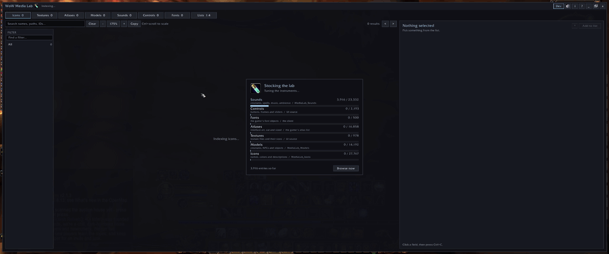
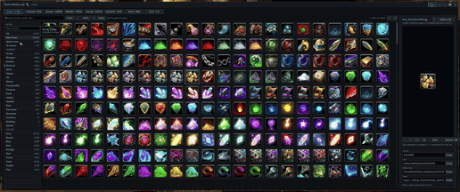
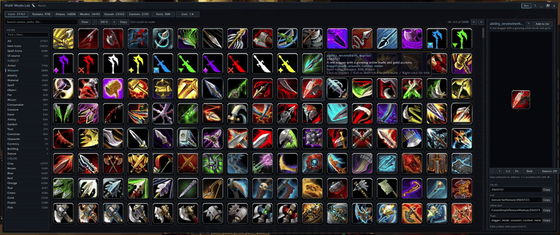
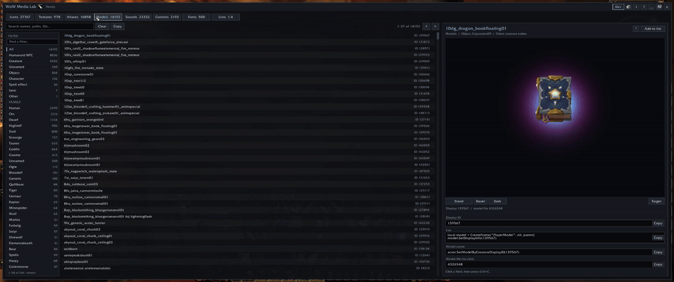
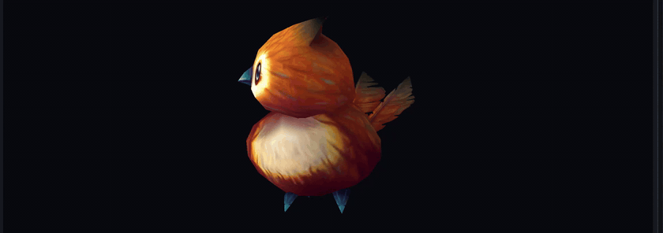
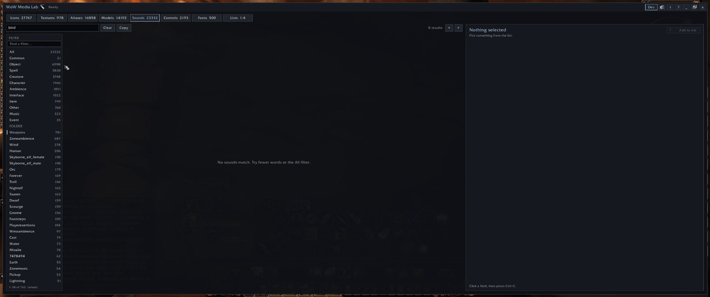
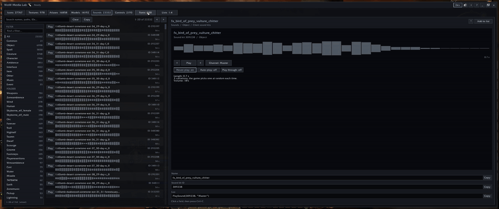

# WoW Media Lab 🧪

**Look through the game's icons, textures, sounds and creature models, all in one window.**

Hunting for the perfect icon for a macro? Want to hear what that sound is
called, or watch a murloc dance? Search, preview and collect everything the
game draws and plays, without leaving the game.

Made for **WoW Forever** (interface **16001**). Version **0.2.1**.

## What you can do

- **Find any icon by what it looks like.** Nearly 28,000 icons, searchable by
  what they show and by color: `sword`, `wolf`, `potion green`.
- **Meet the whole bestiary.** Turn, zoom and animate over 14,000 creature
  models, and target any NPC to see which model it uses.
- **Hear the game's sounds.** Over 23,000 of them, with waveforms and play on
  hover: creatures, spells, music, ambience and the interface.
- **Browse the game's art.** Its textures and the pieces its windows are
  drawn from, zoomed, tiled and on any background.
- **Keep what you like.** Right-click anything to favorite it or put it in
  your own lists, one at a time or a whole selection at once.

## Install

**With CurseForge (recommended, keeps it up to date):** install
[WoW Media Lab from CurseForge](https://www.curseforge.com/wow/addons/wow-media-lab)
in the CurseForge app, and it updates itself whenever a new version comes out.

**Offline, by hand:** download the zip from
[Releases](https://github.com/codelab-chaos/wow-media-lab/releases) and extract
it into `World of Warcraft/_forever_/Interface/AddOns/` (four folders:
`MediaLab` and its three data folders). Come back to Releases for new versions.

Either way, restart the game and make sure **WoW Media Lab** is enabled in the
AddOns list.

## Open it

Type **`/mlab`**, or click it in the addon menu by the minimap. The first time,
a welcome card says hello:

> **Welcome to WoW Media Lab**
>
> - Look through the game's icons, textures, sounds and creature models, all in one window.
> - Type in the search box to find anything: a name, a color, a subject or an ID.
> - Right-click anything to add it to your Favorites or one of your lists.
> - Press ? in the title bar any time for help with the tab you are on and its switches.

Each session, a card counts the libraries in while the lab fills up:

Drag the title bar to move it, the corner to resize it, and the edges of the
side columns to widen them. **_** docks it as an icon at the screen's edge,
the square fills the screen, and Escape closes it. Never use a tab? Untick it
under the **gear** (or in the game's Options, under AddOns) and it no longer
loads.

## A quick tour

### Icons

- Search by what an icon shows (sword, potion, wolf) or by color (blue, gold).
- Filter by subject or color in the left column.
- Hold Ctrl and scroll over the grid to scale the thumbnails up or down.

### Textures and Atlases

- Texture files are whole images the game draws from: frames, backgrounds, borders.
- Atlases are the pieces the game's interface is drawn from, each cut to an exact size.
- Scroll the preview to zoom, drag it to pan, and press Canvas to check it on light or dark.
- Filter by shape (square, wide, tall), or drag the size handles to the sizes you want.
- Filter by shape or size the same way as textures, and zoom the preview to see the detail.

### Models

- Drag a model to turn it any way, middle-drag to move it, scroll to zoom, and press the animation button to see it move.
- Target any NPC and press Target to jump to its model; the lab remembers the name.

### Sounds

- Rest the pointer on a sound to hear it, or press Play; Play through moves on to the next one when it ends.
- The waveform shows how loud a sound is over time, and a playhead follows it while it plays.
- Pick the channel it plays on, so the game's volume sliders apply.
- Filter by Creature, Spell, Music or Ambience in the left column, or search for a creature by name.

### Fonts

- Type your own sample text to see it in any of the game's fonts.

### Controls (a bonus)

- These are the building blocks of the game's windows: buttons, frames, sliders.
- Press Build preview to see a live copy of one.

### Lists

- Favorites and your own lists, with any kind of media in them.
- Ctrl+click or Shift+click to pick several things, then right-click to add them all at once.
- Press New to start a list, and Add to list in the right panel to fill it.

What every button and switch does is in [Every switch](docs/switches.md), and
in the lab under **?**.

## Commands

| Command | Does |
| --- | --- |
| `/mlab` | Opens and closes the lab |
| `/mlab search <words>` | Searches the tab you are on |
| `/mlab tab <name>` | Jumps to a tab: icons, textures, atlases, models, sounds, controls, fonts, lists |
| `/mlab target` | Finds your target's model and remembers its name |
| `/mlab reset` | Puts the window back in the middle at its normal size |
| `/mlab dock <edge>` | Where it minimizes to: left, right, top or bottom |
| `/mlab options` | Picks what loads when the lab opens |
| `/mlab dev` | Turns developer mode on or off |
| `/mlab help` | Lists these in chat |

## Making addons?

Making an addon? Press Dev in the title bar for the code behind each entry.

- Developer mode adds the code for each entry: SetTexture, SetAtlas, PlaySound, CreateFrame and more.
- It also adds a Copy button that copies a whole list or the results as a Lua table.

The [developer guide](docs/addon-dev.md) covers every field you can copy and
what to watch out for.

## Good to know

- **The game's own art and sounds are not bundled.** The lab shows them from
  your own game; it only ships their names and numbers.
- **It stays out of the way.** Nothing loads until you open the lab, and it
  saves only your lists, captured NPC names and settings.
- **Some art may be missing.** A texture the game doesn't have shows as **?**,
  blank or green.

## Feedback

Ideas or bugs? Tell us on the project page: github.com/codelab-chaos/wow-media-lab/issues

Screenshots and the tab you were on help a lot.

## Thanks and license

Icon and model names come from the community
[wow-listfile](https://github.com/wowdev/wow-listfile), and the game's data
tables are read with layouts from [WoWDBDefs](https://github.com/wowdev/WoWDBDefs).
Working on the addon itself is in [docs/development.md](docs/development.md).

[MIT](LICENSE). The game's artwork and audio belong to Blizzard Entertainment
and are not covered by this license.
